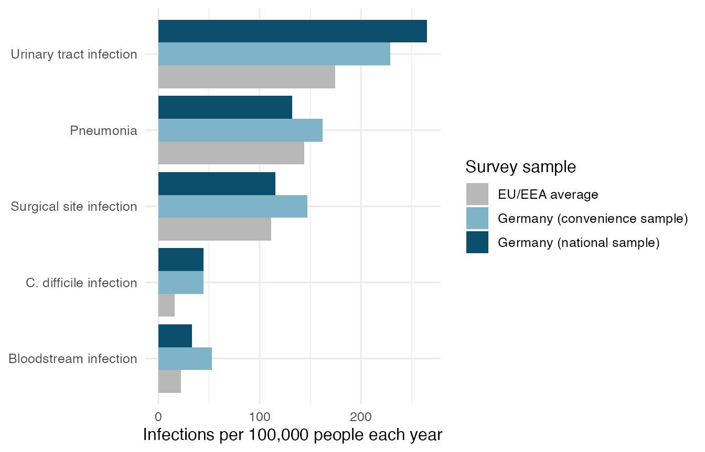
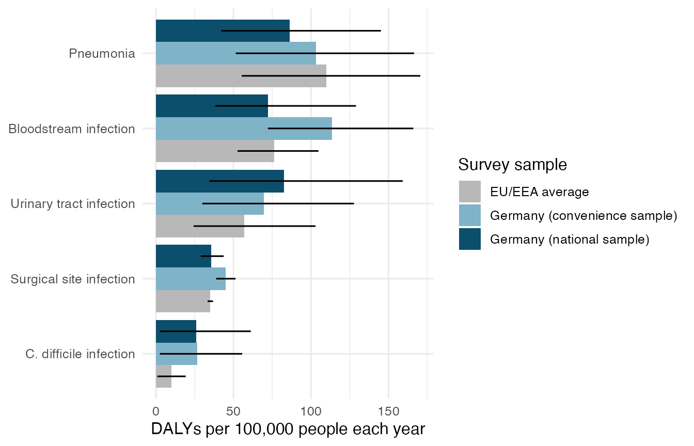

# Exploring the burden of hospital infections

## Who this package is for

This package is for hospital infection control managers. They decide
which infections get prevention money first. The package helps them
answer one question. Is the most common hospital infection also the
infection that does the most harm?

## Install the package

Install the package from GitHub with the remotes package. Then load it.

``` r

# install.packages("remotes")
remotes::install_github("ETC5523-2026/etc5523-assignment-4-cfan0055")
```

``` r

library(haiburden)
```

## The data

The package has one dataset called `hai_burden`. It holds published
estimates for five hospital infections. Each row is one infection in one
survey sample for one measure. All numbers are yearly rates per 100,000
people.

``` r

head(hai_burden)
#> # A tibble: 6 × 6
#>   survey                       infection            measure estimate lower upper
#>   <chr>                        <chr>                <chr>      <dbl> <dbl> <dbl>
#> 1 Germany (national sample)    Pneumonia            Infect…    132   104.  170. 
#> 2 Germany (national sample)    Urinary tract infec… Infect…    265.  217.  314. 
#> 3 Germany (national sample)    Bloodstream infecti… Infect…     33.4  20.5  52.3
#> 4 Germany (national sample)    Surgical site infec… Infect…    115.   93.3 141. 
#> 5 Germany (national sample)    C. difficile infect… Infect…     44.6  31.1  61.8
#> 6 Germany (convenience sample) Pneumonia            Infect…    162.  138.  191.
```

The `measure` column has three values. `Infections` counts new cases.
`Deaths` counts deaths caused by the infection. `DALYs` counts healthy
years lost. Type
[`?hai_burden`](https://etc5523-2026.github.io/etc5523-assignment-4-cfan0055/reference/hai_burden.md)
to read the full description of every column.

## Launch and use the app

Run this code to open the app in your browser.

``` r

run_app()
```

The app has three controls on the left.

1.  **What do you want to count?** Choose the number of infections, the
    number of deaths or the healthy years lost.
2.  **Which survey samples?** Tick one or more samples. The app shows a
    message if you untick all of them.
3.  **Show 95% uncertainty intervals.** Tick this box to add a black
    line to each bar.

Start with the number of infections. Then switch to healthy years lost.
Watch how the order of the bars changes.

## Read the outputs

The chart shows one bar for each infection. The longest bar is at the
top. The sentence under the chart names the largest bar. The table shows
the healthy years lost for every 100 infections.

The same chart can be made outside the app with
[`plot_burden()`](https://etc5523-2026.github.io/etc5523-assignment-4-cfan0055/reference/plot_burden.md).
First count the infections.

``` r

plot_burden(hai_burden, burden_measure = "Infections")
```



Urinary tract infection is the most common infection in Germany and in
the EU/EEA. Bloodstream infection is one of the least common.

Now measure the harm and add the uncertainty intervals.

``` r

plot_burden(hai_burden, burden_measure = "DALYs", show_interval = TRUE)
```



The order changes. Bloodstream infection moves near the top. Urinary
tract infection is no longer first in the EU/EEA. The intervals are
wide, so small gaps between bars are not certain.

The table in the app comes from
[`harm_per_infection()`](https://etc5523-2026.github.io/etc5523-assignment-4-cfan0055/reference/harm_per_infection.md).

``` r

harm_per_infection(hai_burden)
#> # A tibble: 15 × 5
#>    survey                       infection         Infections DALYs dalys_per_100
#>    <chr>                        <chr>                  <dbl> <dbl>         <dbl>
#>  1 EU/EEA average               Bloodstream infe…       22.2  76.2           343
#>  2 EU/EEA average               Pneumonia              144.  110.             76
#>  3 EU/EEA average               C. difficile inf…       16    10              62
#>  4 EU/EEA average               Urinary tract in…      175.   57.1            33
#>  5 EU/EEA average               Surgical site in…      111.   35.1            32
#>  6 Germany (convenience sample) Bloodstream infe…       52.7 114.            215
#>  7 Germany (convenience sample) Pneumonia              162.  103.             64
#>  8 Germany (convenience sample) C. difficile inf…       44.5  26.5            60
#>  9 Germany (convenience sample) Surgical site in…      147.   45              31
#> 10 Germany (convenience sample) Urinary tract in…      229.   69.5            30
#> 11 Germany (national sample)    Bloodstream infe…       33.4  72.2           216
#> 12 Germany (national sample)    Pneumonia              132    86.1            65
#> 13 Germany (national sample)    C. difficile inf…       44.6  25.9            58
#> 14 Germany (national sample)    Urinary tract in…      265.   82.6            31
#> 15 Germany (national sample)    Surgical site in…      115.   35.7            31
```

In the German national sample, 100 bloodstream infections cost about 216
healthy years. 100 urinary tract infections cost about 31 healthy years.
One bloodstream infection is about seven times as harmful. The answer to
the question is no. The most common infection is not the most harmful
one.

## Limits of the data

These numbers are model estimates from hospital surveys in 2011 and
2012. Each survey looked at a hospital on a single day. The numbers may
be different in hospitals today.

## Source

Zacher B, Haller S, Willrich N, et al. (2019). Application of a new
methodology and R package reveals a high burden of healthcare-associated
infections (HAI) in Germany compared to the average in the European
Union/European Economic Area, 2011 to 2012. *Eurosurveillance*, 24(46),
1900135.
