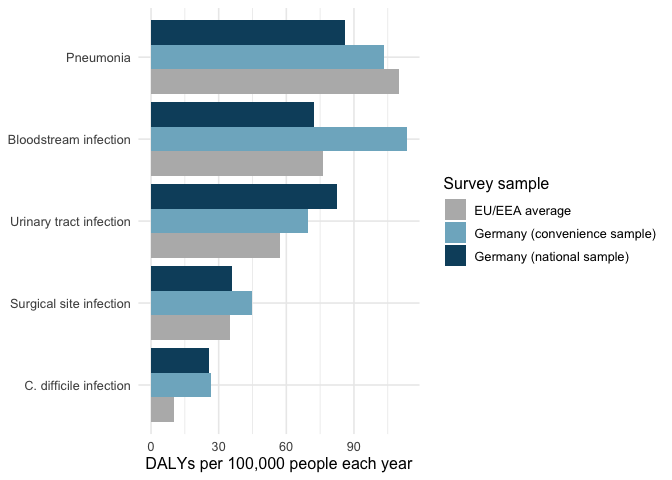

# haiburden

haiburden helps you compare five infections that patients catch in
hospital. It is for hospital infection control managers. They decide
which infections get prevention money first. The package answers one
question. Is the most common hospital infection also the infection that
does the most harm? You can rank the infections by number of cases,
deaths or healthy years lost. The ranking changes with the measure.

## Website

The package website is at
<https://etc5523-2026.github.io/etc5523-assignment-4-cfan0055/>.

## Installation

You can install haiburden from GitHub with this code.

``` r

# install.packages("remotes")
remotes::install_github("ETC5523-2026/etc5523-assignment-4-cfan0055")
```

## Launch the app

Run this code to open the interactive app.

``` r

library(haiburden)
run_app()
```

## Example

This example ranks the infections by healthy years lost.

``` r

library(haiburden)
plot_burden(hai_burden, burden_measure = "DALYs")
```



Bloodstream infection is near the top of this chart. It is one of the
least common infections, so each case does a lot of harm.

## Data

The dataset `hai_burden` holds published estimates for Germany and the
EU/EEA from hospital surveys in 2011 and 2012. The numbers come from
Table 2 of Zacher et al. (2019) in *Eurosurveillance*. The code that
builds the dataset is in the `data-raw` folder.

## What is in the package

| Object | What it does |
|----|----|
| `hai_burden` | Dataset of cases, deaths and healthy years lost for five infections |
| [`plot_burden()`](https://etc5523-2026.github.io/etc5523-assignment-4-cfan0055/reference/plot_burden.md) | Draws a bar chart for one measure |
| [`harm_per_infection()`](https://etc5523-2026.github.io/etc5523-assignment-4-cfan0055/reference/harm_per_infection.md) | Calculates healthy years lost for every 100 infections |
| [`run_app()`](https://etc5523-2026.github.io/etc5523-assignment-4-cfan0055/reference/run_app.md) | Opens the Shiny app |

## AI-use declaration

I used generative AI tools while preparing this assignment. Claude
(Anthropic) explained the overall steps for building an R package with a
Shiny app and a pkgdown website. It answered my questions about the
structure of the package and the app. It pointed out steps I had missed
and helped me fix bugs in my code. It also gave example code and example
text. I reviewed, ran and tested this material, and I changed parts of
it before using it. I checked the final package and app myself, and I am
responsible for this submission.
